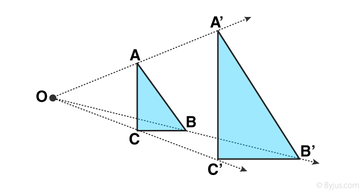

```{=html}
<div class="lesson-dashboard" id="lesson-dashboard">
<div class="lesson-search">
<label for="lesson-search-input">Search lessons</label>
<input id="lesson-search-input" type="search" placeholder="Try a title or topic, such as rotations" autocomplete="off" aria-describedby="lesson-search-help">
<p id="lesson-search-help" class="lesson-search-help">Search by lesson title or mathematics topic.</p>
</div>

<p id="lesson-search-status" class="lesson-search-status" role="status" aria-live="polite">Showing 2 lessons</p>

<section class="lesson-grid" aria-label="Available lessons">
<a class="lesson-card" href="rotations.html" data-search="rotations coordinate plane geometry high school transformations">
<div class="lesson-card-thumbnail">

</div>
<div class="lesson-card-content">
<p class="lesson-card-subject">High school geometry</p>
<h2>Rotations on the Coordinate Plane</h2>
<div class="lesson-card-dates" aria-label="Lesson dates">
<p>Created <time datetime="2026-10-18">October 18, 2026</time></p>
<p>Last modified <time datetime="2026-10-19">October 19, 2026</time></p>
</div>
<span class="lesson-card-action">Open lesson <span aria-hidden="true">→</span></span>
</div>
</a>
<a class="lesson-card" href="dilations.html" data-search="dilations coordinate plane geometry high school transformations scale factor">
<div class="lesson-card-thumbnail">

</div>
<div class="lesson-card-content">
<p class="lesson-card-subject">High school geometry</p>
<h2>Dilations on the Coordinate Plane</h2>
<div class="lesson-card-dates" aria-label="Lesson dates">
<p>Created <time datetime="2026-10-19">October 19, 2026</time></p>
<p>Last modified <time datetime="2026-10-19">October 19, 2026</time></p>
</div>
<span class="lesson-card-action">Open lesson <span aria-hidden="true">→</span></span>
</div>
</a>
</section>

<p id="lesson-search-empty" class="lesson-search-empty" hidden>No lessons match that search. Try another title or topic.</p>
</div>
<script src="lessons-dashboard.js" defer></script>
```
